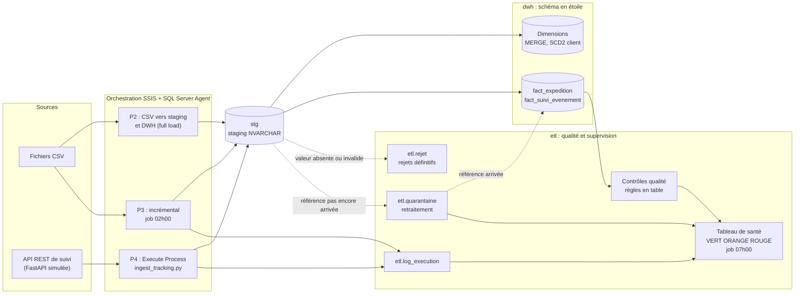
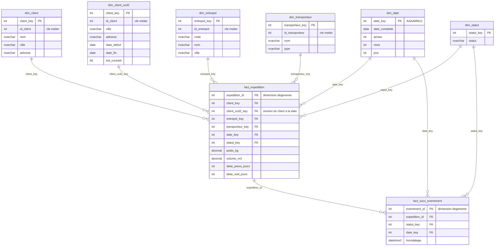

# TransLog Maroc : pipeline ETL SSIS vers Data Warehouse

Projet personnel d'apprentissage sur un cas logistique **fictif** (transport routier de marchandises). Toutes les données sont synthétiques et générées par un script reproductible.

## En bref

Pipeline de données industrialisé, de la source au tableau de santé, sur SQL Server et SSIS :

- **Deux sources** : fichiers CSV (expéditions, clients, entrepôts, transporteurs) et une API REST de suivi des expéditions (paginée, authentifiée, avec pannes simulées).
- **Data Warehouse en étoile** : faits des expéditions et des événements de suivi, dimension client historisée (SCD type 2).
- **Chargement incrémental et rejouable** : watermark, `MERGE`, idempotence vérifiée par des tests de rejeu.
- **Qualité** : rejets tracés avec leur motif, quarantaine et retraitement automatique des lignes dont la référence arrive en retard, règles métier déclarées dans une table.
- **Supervision** : journal d'exécution de chaque flux, fraîcheur, taux de rejet, tableau de santé VERT / ORANGE / ROUGE, alerte par un job SQL Server Agent.
- **Orchestration** : packages SSIS ; le chargement incrémental est déployé dans SSISDB et planifié par SQL Server Agent ; le package d'ingestion API appelle Python et réagit à son code de sortie.

## Architecture



Schéma en étoile (relations réelles des tables, clés étrangères comprises) :



`dwh.dim_client_scd2` historise les changements de ville et d'adresse (`date_debut`, `date_fin`, `est_courant`). Chaque expédition pointe à la fois vers `dim_client` (`client_key`, valeurs actuelles) et vers la version du client valide à la date de l'expédition (`client_scd2_key`).

Grains :

- `fact_expedition` : une ligne par expédition (`expedition_id` en dimension dégénérée). Mesures : poids, volume, délais prévu et réel.
- `fact_suivi_evenement` : une ligne par événement de suivi reçu de l'API (`evenement_id` en dimension dégénérée).

## Compétences mises en œuvre

| Compétence | Où dans le dépôt |
|---|---|
| Modélisation dimensionnelle, grain, SCD type 2 | `02_schema_dwh.sql`, `05_scd2_client.sql`, `09_tracking_events.sql` |
| T-SQL : `MERGE`, CTE, window functions, procédures, transactions | `03` à `12` |
| SSIS : Data Flow, Lookup, Conditional Split, variables, expressions, paramètres de projet, OnError | `ssis/TransLog_ETL/` |
| Chargement incrémental, watermark, idempotence | `06_incremental_expeditions.sql`, P4 |
| Ingestion d'API REST : clé, pagination, backoff, codes de sortie | `api/`, `tests/` |
| Qualité : rejets, quarantaine, règles en table | `04`, `10`, `11` |
| Supervision et alerte | `07`, `12`, `12b` |
| Déploiement SSISDB et SQL Server Agent | `08_agent_job.sql`, `12b_job_verification_sante.sql` |
| Tests | `tests/` (Pytest), scénarios `06b`, `11b`, `12c` |

## Contenu du dépôt

```
gen_translog.py          génération des CSV synthétiques (graine fixe)
data/                    CSV générés (avec anomalies volontaires)
01_staging.sql           base, schémas, tables de staging, chargement initial
02_schema_dwh.sql        tables du schéma en étoile
02b_load_dim_date.sql    alimentation de dim_date (année 2026)
03_load_dimensions.sql   procédures MERGE des dimensions
04_rejets.sql            table etl.rejet et procédure de journalisation
05_scd2_client.sql       dimension client historisée (SCD type 2)
06_incremental_expeditions.sql  chargement incrémental de la table de faits (watermark)
06b_test_incremental.sql        scénario de test du chargement incrémental
07_log_execution.sql     journal d'exécution des packages (etl.log_execution)
08_agent_job.sql         job SQL Server Agent qui lance P3_Incremental chaque nuit
09_tracking_events.sql   P4 : staging, table de faits des événements de suivi, procédure de chargement
09b_run_tracking_manual.sql  P4 : exécution manuelle et contrôles
10_qualite.sql           P5 : framework de contrôles qualité (règles, exécuteur, résultats)
11_quarantaine.sql       P5 : quarantaine et retraitement des rejets
11b_test_retraitement.sql    P5 : scénario de test du retraitement
12_supervision.sql       P6 : supervision (santé des flux, tableau de santé, alertes)
12b_job_verification_sante.sql  P6 : job SQL Server Agent de vérification (07h00)
12c_test_supervision.sql P6 : scénario de test de la supervision
13_lien_faits_scd2.sql   liaison de fact_expedition à la version SCD2 du client
api/                     P4 : API REST simulée (FastAPI) et script d'ingestion
tests/                   tests Pytest de l'ingestion API
ssis/TransLog_ETL/       projet SSIS (packages P2_Charge_Staging, P3_Incremental, P4_Tracking)
```

## Prérequis

- SQL Server (testé avec SQL Server 2025 Developer) et SSMS
- Visual Studio avec l'extension SQL Server Integration Services Projects
- Python 3, optionnel, pour régénérer les CSV

## Exécution

1. Optionnel : `python gen_translog.py data` régénère les CSV (résultat identique grâce à la graine fixe).
2. Placer le dépôt dans `C:\TransLog` (les chemins du script 01 en dépendent).
3. Dans SSMS, exécuter dans l'ordre : `01`, `02`, `02b`, `03`, `04`, puis `05`, `06` et `07`.
   Les scripts `01` et `02` recréent les tables : à n'utiliser qu'à l'initialisation.
4. Ouvrir `ssis/TransLog_ETL/TransLog_ETL.slnx` dans Visual Studio, ouvrir `P2_Charge_Staging.dtsx`, puis exécuter (F5).
5. Pour la suite (P3 à P6), exécuter `08`, puis `09`, `10`, `11`, `12`, `12b` et `13`. Chaque étape est détaillée dans sa section ci-dessous, avec son script de test (`06b`, `09b`, `11b`, `12c`).

Connexion utilisée : `localhost`, authentification Windows, base `translog_dw`.

## Résultats attendus du chargement initial (P2)

| Couche | Contenu |
|---|---|
| Staging | 8 entrepôts, 6 transporteurs, 60 clients, 3003 expéditions |
| DWH | 2995 lignes dans `fact_expedition` |
| Rejets | 8 lignes dans `etl.rejet` |

Les 8 lignes rejetées :

| Motif | Lignes |
|---|---|
| doublon | 3 |
| date inconnue (vide ou hors 2026) | 2 |
| statut inconnu | 1 |
| client inconnu | 1 |
| entrepôt inconnu | 1 |

Relancer le package donne le même résultat : le staging et la table de faits sont vidés avant chaque chargement, et les dimensions utilisent un `MERGE`.

## Choix de conception

- **Staging en NVARCHAR** : on charge tel quel, les erreurs de type ne bloquent jamais le chargement. Les conversions se font à la lecture, avec `TRY_CAST`.
- **Dimensions par `MERGE`** : insertion des nouveautés, mise à jour des valeurs modifiées, aucune suppression.
- **Statut en liste fixe** : c'est un référentiel. Une valeur inconnue n'entre pas dans la dimension, elle est rejetée.
- **Table de faits** : un Data Flow avec un `Conditional Split` pour les doublons et 5 `Lookup` qui récupèrent les clés de substitution. Les lignes sans correspondance sortent par la sortie *No Match*.
- **Rejets journalisés en T-SQL** après le Data Flow, avec le motif de chaque ligne.

## P3 : dimension client historisée (SCD type 2)

Script : `05_scd2_client.sql`. La ville et l'adresse sont historisées.

- Table `dwh.dim_client_scd2` : une ligne par version, avec `date_debut`, `date_fin` et `est_courant`. La version courante a `date_fin = 9999-12-31`.
- Procédure `etl.usp_load_dim_client_scd2 @date_effet`, en deux temps dans une transaction :
  1. fermeture des versions courantes dont la ville ou l'adresse a changé (`date_fin` = veille de `@date_effet`) ;
  2. création d'une version courante pour tout client qui n'en a pas (nouveau client ou version fermée).
- Rejouable : une relance sans changement dans le staging n'écrit rien (61 lignes avant et après).
- Les périodes sont fermées aux deux bornes (`date_fin` = veille du changement) : une date tombe dans une seule version, la recherche à une date donnée utilise donc `BETWEEN date_debut AND date_fin`.

### Liaison des faits à l'historique (`13_lien_faits_scd2.sql`)

`fact_expedition.client_scd2_key` pointe vers la version du client valide à la date de l'expédition :

```sql
JOIN dwh.dim_client_scd2 v
  ON v.id_client = c.id_client
 AND d.date_complete BETWEEN v.date_debut AND v.date_fin
```

- La première version de chaque client est valide depuis `1900-01-01`, pour que les expéditions antérieures au premier chargement trouvent aussi leur version.
- `etl.usp_lier_faits_scd2` est rejouable (ne modifie que les faits sans version ou mal liés). Elle est appelée à la fin du chargement incrémental et du retraitement de la quarantaine.
- Résultat : 3000 expéditions liées, 0 sans version. Le client 7, qui a déménagé d'Oujda à Fès le 15 juin 2026, a 35 expéditions rattachées à sa version d'Oujda et 31 à sa version de Fès ; `dim_client` (type 1) les attribue toutes à Fès.

## Chargement incrémental de la table de faits (watermark)

Script : `06_incremental_expeditions.sql`, test : `06b_test_incremental.sql`.

- Table de contrôle `etl.watermark` : plus grand `expedition_id` déjà chargé, initialisé à partir de la table de faits.
- Procédure `etl.usp_load_fact_expedition_incr` : ne charge que les expéditions au-dessus du repère, résout les clés de substitution par jointure sur les dimensions, puis avance le repère dans la même transaction que l'insertion.
- Rejouable : un second passage ne charge aucune ligne.
- Choix du repère : la source CSV n'a pas de date de modification, le watermark porte donc sur l'identifiant croissant.

## Déploiement et planification

1. Dans Visual Studio, `Build > Rebuild` produit `bin/Development/TransLog_ETL.ispac`.
2. Dans SSMS, créer le catalogue SSISDB (Integration Services Catalogs) et un dossier `TransLog`.
3. Clic droit sur `Projects > Deploy Project`, choisir le fichier `.ispac`, serveur `localhost`, chemin `/SSISDB/TransLog/TransLog_ETL`.
4. Exécuter `08_agent_job.sql` pour créer le job `TransLog - Charge faits incremental` (étape de type SSIS Catalog, planification quotidienne à 02h00).
5. Contrôle : `catalog.executions` (status 7 = succès, 4 = échec) et `etl.log_execution`.

Point d'attention : le job tourne sous le compte du service SQL Server Agent. Un package dont le `LocaleID` vaut 3072 (culture personnalisée générique de Windows) échoue sous ce compte avec l'erreur `Culture is not supported`, alors qu'il passe depuis SSMS. Le `LocaleID` de P3_Incremental est donc fixé à 1036 (français).

## P4 : ingestion depuis une API REST de suivi

Flux : API simulée (FastAPI) -> `api/ingest_tracking.py` -> CSV -> `stg.tracking_events` -> `dwh.fact_suivi_evenement`.

- Grain : un événement de suivi d'une expédition.
- Authentification par clé (`X-API-Key`), jamais committée.
- Pagination par curseur (`after_id`), qui sert aussi de watermark.
- Reprise automatique sur 503 et 429 avec backoff ; arrêt immédiat sur clé refusée.
- Écriture atomique du CSV (fichier temporaire puis renommage).
- Staging entièrement en `NVARCHAR` : le typage et les contrôles se font dans la procédure, une ligne invalide part en rejet sans bloquer le lot.
- Codes de sortie : 0 OK, 2 API indisponible, 3 authentification refusée, 4 réponse invalide, 5 configuration manquante.

Résultats du premier chargement :

- 4727 événements reçus en 10 pages (limit 500), 2 erreurs 503 reprises automatiquement.
- 4720 chargés, 7 rejetés (expédition inconnue), tracés dans `etl.rejet` : 4720 + 7 = 4727.
- 2e exécution : 0 ligne, watermark inchangé (idempotence).

Lancer :

```powershell
pip install -r api\requirements.txt
python -m pytest -q
$env:TRANSLOG_API_KEY="cle-de-demo"
python -m uvicorn api.mock_api:app --port 8000        # fenêtre 1
python api\ingest_tracking.py --after-id <watermark>  # fenêtre 2
```

Puis exécuter `09b_run_tracking_manual.sql` dans SSMS.

### Package SSIS `P4_Tracking`

Le flux complet est orchestré par SSIS :

```
SQL - Lire watermark        -> User::WM
Process - Ingestion API     python api\ingest_tracking.py --after-id <WM> --base-url <ApiBaseUrl>
SQL - Charger staging       TRUNCATE + BULK INSERT du CSV
SQL - Charger faits         etl.usp_load_tracking_events -> NbCharges, NbRejetes, AncienWM, NouveauWM
SQL - Retraitement          etl.usp_retraitement (quarantaine)
SQL - Controles qualite     etl.usp_run_controles
SQL - Log succes            etl.usp_log_execution
OnError (package)           SQL - Log echec avec System::ErrorDescription
```

- Paramètres de projet `PythonExe`, `RacineProjet`, `ApiBaseUrl` : changer d'environnement ne demande pas d'ouvrir le package.
- Les arguments de Python sont construits par une expression sur le watermark lu en base.
- Execute Process Task : tout code de sortie différent de 0 fait échouer la tâche (2 = API indisponible, 3 = clé refusée...), donc le package, donc la supervision passe au ROUGE.
- Tâches strictement chaînées : sans contrainte de précédence, SSIS lancerait les tâches en parallèle (chargement des faits avant la fin du staging).
- Le package journalise sous `System::PackageName` = `P4_Tracking`, le nom attendu par `etl.flux_supervision`.
- La clé d'API est lue par le script dans `api/.api_key` (non versionné) : le package ne voit pas les variables d'environnement d'une session PowerShell.

Tests réalisés :

- API disponible : 7 tâches au vert, ligne `P4_Tracking SUCCES` dans `etl.log_execution`.
- API arrêtée : 5 essais avec backoff (1, 2, 4, 8, 16 s), code de sortie 2, ligne `P4_Tracking ECHEC` avec le message d'erreur, `P4_Tracking` au ROUGE dans `etl.v_sante_flux`.
- Leçon d'un test précédent : quand le gestionnaire OnError était mal paramétré, l'échec n'était pas journalisé et la supervision restait au VERT. Une supervision ne vaut que si la journalisation de l'échec est elle-même testée.

## P5 : framework de contrôles qualité

Principe : les règles métier sont des données, pas du code. Ajouter une règle revient à faire un `INSERT`, sans modifier ni redéployer de procédure.

- `etl.regle_qualite` : une ligne par règle (flux, dimension, gravité, requête SQL qui renvoie les clés en défaut).
- `etl.usp_run_controles` : exécute chaque règle active (`sp_executesql`), écrit OK ou KO, et ERREUR si la requête elle-même est cassée, sans arrêter les autres règles.
- `etl.controle_resultat` : historique par exécution (`execution_id`), base de la supervision.
- `etl.controle_anomalie` : les clés en défaut, pour savoir quelles lignes corriger.

Deux lignes de défense :

1. À l'entrée, dans les procédures de chargement : typage, doublon, clé inconnue. La ligne part dans `etl.rejet`.
2. Après le chargement, sur le DWH : règles métier de complétude et de plausibilité, avec une gravité (BLOQUANT ou AVERTISSEMENT).

Une règle = une dimension = un motif clair : un poids négatif (plausibilité) et un poids absent (complétude) sont deux règles distinctes.

Résultat sur le jeu de données :

| Règle | Gravité | Résultat |
|---|---|---|
| EXP_POIDS_NON_POSITIF | BLOQUANT | KO (expédition 26) |
| EXP_VOLUME_ABSENT | AVERTISSEMENT | KO (expédition 141) |
| EXP_POIDS_EXTREME | AVERTISSEMENT | KO (expédition 41, 4 500 t) |
| EXP_POIDS_ABSENT | BLOQUANT | OK |

Le seuil de 30 t est un seuil métier (charge utile d'un poids lourd, hypothèse générale), vérifié contre la médiane et le 99e percentile plutôt que contre la moyenne, elle-même faussée par la valeur aberrante.

Test de robustesse : une règle volontairement fausse (colonne inexistante) sort en ERREUR avec son message, et les autres règles s'exécutent normalement.

```sql
EXEC etl.usp_run_controles;                        -- toutes les règles
EXEC etl.usp_run_controles @flux = 'expeditions';  -- un flux
```

### Quarantaine et retraitement des rejets

Problème : un fait peut arriver avant sa référence (un client, un entrepôt, une expédition). Le rejeter pour toujours perd la donnée ; le charger avec une référence inventée la fausse.

Choix : quarantaine. La ligne brute est gardée en JSON dans `etl.quarantaine`, puis retentée à chaque exécution :

```
A_RETRAITER --(référence arrivée)--> RETRAITE
     +------(5 essais sans succès)--> ABANDONNE
```

- Seuls les motifs « inconnu » (référence pas encore disponible) vont en quarantaine. Une valeur absente ou mal formée reste un rejet définitif dans `etl.rejet`.
- Le retraitement retrouve la ligne par sa clé, pas par le watermark : un événement rejeté n'est plus perdu quand le watermark avance.
- Ordre imposé par `etl.usp_retraitement` : les expéditions d'abord, puis leurs événements.
- `etl.fn_motif_expedition` (inline table-valued function) écrit les motifs une seule fois pour le chargement et le retraitement.
- Un nouveau motif `expedition absente` (complétude) est distingué de `expedition inconnue` (intégrité référentielle).
- Rejouable : contrainte `UNIQUE (table_source, cle_source)`, et plus de rejet journalisé deux fois.

Scénario testé (`11b_test_retraitement.sql`) :

- 7 événements de suivi rejetés en cascade : leurs expéditions (56, 71, 86) avaient elles-mêmes été rejetées.
- 5 expéditions en quarantaine : 56 (statut inconnu), 71 et 3004 (client inconnu), 86 (entrepôt inconnu), 101 (date 2031 hors calendrier).
- Arrivée simulée des clients 999 et 9999 : les expéditions 71 et 3004 sont chargées, puis les événements 3052 et 3064 de l'expédition 71.
- Restent en attente : 56, 86, 101 et leurs 5 événements. L'expédition 101 ne se corrigera pas seule (date erronée) : elle passera à ABANDONNE après 5 essais.

```sql
EXEC etl.usp_retraitement;
SELECT table_source, statut, COUNT(*) FROM etl.quarantaine GROUP BY table_source, statut;
```

## P6 : supervision des flux

Quatre indicateurs par flux, résumés en un feu VERT / ORANGE / ROUGE :

- statut de la dernière exécution (SUCCES ou ECHEC) ;
- fraîcheur : heures depuis le dernier **succès** (pas depuis la dernière exécution) ;
- taux de rejet de la dernière exécution ;
- qualité : règles KO de la dernière exécution des contrôles, lignes abandonnées en quarantaine.

```
ROUGE  : jamais réussi, dernière exécution en échec, ou aucun succès depuis 2 périodes
ORANGE : aucun succès depuis 1 période (retard), ou taux de rejet au-dessus du seuil
VERT   : sinon
```

- `etl.flux_supervision` : ce qu'on attend de chaque flux (fréquence, seuil de rejets). Changer une attente est un `UPDATE`, pas une modification de code.
- `etl.v_sante_flux` : feu par flux, à partir de `etl.log_execution`.
- `etl.v_tableau_sante` : tableau de santé complet (flux, qualité, quarantaine).
- `etl.usp_verifier_sante` : historise chaque anomalie dans `etl.alerte` et échoue (`THROW 50100`) s'il y a du ROUGE.
- Job SQL Server Agent `TransLog - Verification sante`, chaque jour à 07h00, après le chargement de 02h00 : le job passe en échec quand un composant est au ROUGE. L'alerte est découplée du canal : un e-mail (Database Mail et operator) peut être branché sur le job sans rien réécrire.
- `etl.usp_run_tracking_events` : partie base de données du flux P4, journalisée en SUCCES ou ECHEC.
- `etl.usp_log_execution` accepte le nombre de rejets, en dernier paramètre : les appels existants du package P3 restent valides.

Résultat sur le jeu de données : les deux flux sont au VERT, la quarantaine aussi (aucune ligne abandonnée), la qualité est au ROUGE à cause de la règle bloquante `EXP_POIDS_NON_POSITIF` (expédition 26). La vérification échoue donc, comme attendu, avec le message `1 composant(s) au ROUGE`.

```sql
SELECT * FROM etl.v_tableau_sante;
EXEC etl.usp_verifier_sante @echouer_si_rouge = 0;   -- consultation
EXEC etl.usp_verifier_sante;                          -- comportement du job
```

## Auteur

Omar (github.com/Chekroun2004)
